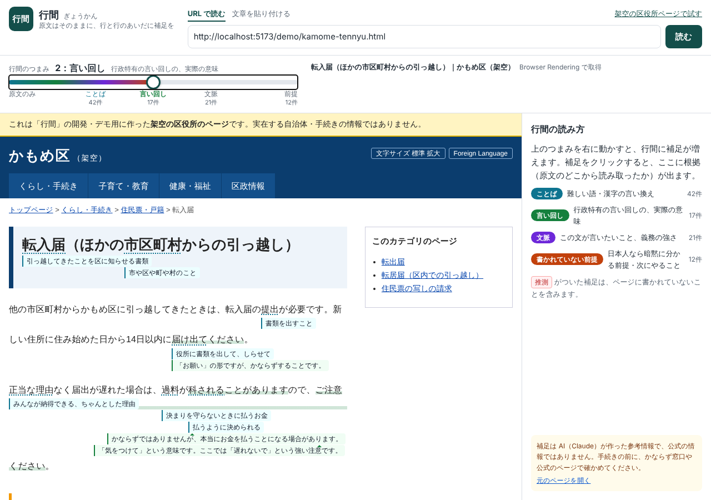
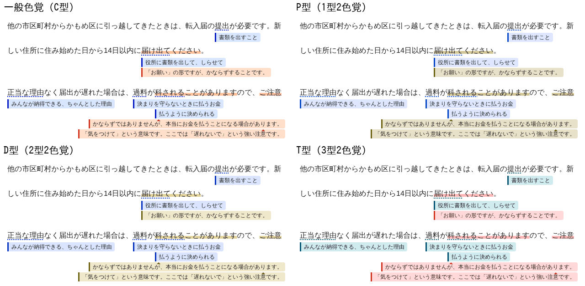

# PROGRESS

最終更新: 2026-11-03（提出締切 2026-11-08 20:00 JST まで約5日）

## いまの状態

**実在のページ（出入国在留管理庁「在留期間更新許可申請」）で、最初から最後まで動きます。**

URL を入れる → Browser Rendering（ヘッドレス Chrome）で取得 → 元の見た目のまま表示 → 文に分けて ID を振る → つまみ 0〜4 で**各行の下に**補足が増える → 補足をクリックすると根拠が出る

- 原文の折り返しは、つまみ 0 と 4 で変わりません。入管ページ（全100ブロック）を 360・390・768・1024・1280px で測り、どの行も同じ文字から始まることを確かめました。架空ページも同様です。
- 入管ページの補足は112件（ことば56・言い回し22・文脈21・前提13）。**このセッションの Claude（Claude Code）が**、Worker と同じプロンプト・出力形式で作り、同じ検証器に通したものです（Claude API は未使用。ご指示どおりクラウドセッションのクレジットで作成）。
- 任意の URL の補足を**その場で**作るには Claude API キーが要ります（Worker と CLI に実装済み。未実行）。それまでは、セッションで作った補足を取り込んだページと、同梱の架空ページだけに補足が出ます。

## 行間の詰め方と色（3回目のフィードバック）

**補足を上に詰めた（階段状をやめた）。**

- 補足の行の中を段に分け、ほかの補足と重ならない、いちばん上の段に入れる（`src/lib/pack.ts`）。
- 置く順番は「レベルの低い順 → 同じレベルの中では左から」。こうすると、つまみを上げ下げしても、見えている補足の位置は変わらない。新しく出る補足だけが、空いたところか下の段に入る。
- 補足の幅は、文字数からの見積もりをやめて実際に測る（一度測った幅は覚えておく）。
- 確かめたこと:
  - 入管ページと架空ページ、それぞれ 390px と 1280px で、つまみ 1〜4 のどれでも「重なり 0」「上の段が空いているのに下にいる補足 0」。
  - 折り返しが変わらないことも再確認した（入管ページは 360〜1280px の5つの幅、架空ページは 390px と 1280px）。

**色を、デジタル庁デザインシステムのカラートークンから選び直した。**

色は `src/lib/tokens.css` にまとめた。値は `@digital-go-jp/design-tokens` 2.1.0（MIT License）。

| レベル   | 線・チップの色 | 補足の背景 | 色以外の手がかり                 |
| -------- | -------------- | ---------- | -------------------------------- |
| ことば   | blue-900       | blue-100   | 原文の語に点線の下線             |
| 言い回し | orange-800     | orange-100 | 原文の語にマーカー（orange-200） |
| 文脈     | cyan-900       | cyan-50    | 文への補足（行の左端から始まる） |
| 前提     | magenta-800    | magenta-50 | 左の線が破線。必ず「推測」と書く |

- **選び方:** デザインシステムの「カラー：アクセシビリティ」の方針に沿った。
  - 文字は背景に対して 4.5:1 以上、文字以外は 3:1 以上
  - 色だけで情報を区別しない
  - カラーユニバーサルデザイン推奨配色セットを参考にする
- **いちばん多い2つ:** 「ことば」と「言い回し」は、色覚の型によらず見分けやすい青とオレンジにした。
- **色覚シミュレーションでの見分けやすさ:** P型・D型・T型の2色覚で色差（CIEDE2000）を測った。ことば・言い回し・文脈の3色で、いちばん近い組の色差は **5.7 から 17.4** に上がった。以前の色では、T型でことばと言い回しがほぼ同じ色に見えていた。
- **前提の赤紫:** P型では青と近く見えるので、破線と「推測」でも区別する。
- **テスト（`src/lib/tokens.test.ts`）:** この基準をテストにした。
  - 値がデザインシステムと同じか
  - コントラスト比
  - 色覚シミュレーションでの色差
  - アプリと iframe の CSS に色を直接書いていないか（トークンだけを使う）
- **アプリ全体の色:** トークンにそろえた。
  - 入力欄と区切り線は、白に対して 3:1 以上（solid-gray-420）にした。以前は約 1.3:1 だった。
  - キーカラーは、レベルの4色と別の色相の緑（green-900）にした。以前の青緑 #134e4a に近い色。

**あわせて直したこと（アクセシビリティ。デザインシステムを参考にした）**

- **フォーカスの印:** キーボードで補足に移ったときの印を、デザインシステムのフォーカスの印（黄と黒の2重）にした。以前はほとんど見えなかった。
- **見えない補足:** 表示していないレベルの補足にもキーボードで移れて、読み上げもされていた。畳んだ補足は `visibility: hidden` にして、どちらでも飛ばすようにした。
- **選んだ補足の枠:** 内側の要素に切り取られて見えていなかったので、外側に付け直した。
- **言い回しのマーカー:** 語が行をまたぐと、途中に差し込んだ補足の行の上にも帯が出ていた。背景で塗るのをやめ、太い下線で引くようにした。
- **測り直したときの動き:** 幅を変えて測り直すたびに、出ていた補足がもう一度広がる動きをしていたので止めた。新しく届いた補足だけが広がる。

## 補足の見た目の整理（2回目のフィードバック）

- 補足の中の「ことば」「言い回し」などのラベルと「〔単語〕：」を外し、**補足の本文だけ**にした。レベルは色で、どの語への補足かは位置（語の真下から始まる）で分かる。
- レベル名と語は、マウスを乗せたときのツールチップ・読み上げ用のラベル（`aria-label`）・クリックしたときの根拠パネルに残した。色の凡例は右のパネルにある。
- 1行に収めるために補足を語より左へずらしたときだけ、語の真下に小さな▲を付ける（位置で語が分からなくならないように）。
- 意味の分からなさが変わるバッジ（文脈の「かならず」「なるべく」など、前提の「推測」）は残した。「ページの外の知識」は、語や言い回しの意味の説明（ことば・言い回し）では外し、文脈・前提でだけ付ける。根拠パネルでは、どのレベルでも「このページに書いてある／一般的な知識／推測」を出す。
- 折り返しが変わらないことを再確認した（入管ページ 390・1280px、架空ページ 1280px）。

## 前回のフィードバックへの対応

| フィードバック                                        | 対応                                                                                                                                                 |
| ----------------------------------------------------- | ---------------------------------------------------------------------------------------------------------------------------------------------------- |
| ネットワークをフルにした                              | 入管・新宿区・JLPT のページを Browser Rendering で取得できることを確認（下の「わかったこと」も参照）                                                 |
| Claude API はいったんクラウドセッションのクレジットで | 入管ページの補足をこのセッションで作成。下書き → 検証（`build-fixture.ts --strict`）→ 開発用 KV に取り込み（`import-notes.ts`）の流れを用意          |
| Workers 1本で OK                                      | そのまま                                                                                                                                             |
| 補足は「各行の下」でないとコンセプトに合わない        | 作り直した。文字ごとに位置を測って画面上の行を求め、行末に小さな文字の補足の行を差し込む。語への補足はその語の真下から始める。幅が変わったら測り直す |
| ふりがなは不要                                        | 語の上の読みを撤去。読みは根拠パネルにだけ出す                                                                                                       |
| .go.jp / .lg.jp 以外にも公的な性格のサイトがある      | 既定でどの公開サイトも読めるようにした（`ALLOWED_HOSTS="*"`）。localhost とプライベート IP だけは本番で拒否                                          |
| 貼り付けた文章はキャッシュしない                      | そのまま                                                                                                                                             |
| 当面は Free プラン                                    | Free の CPU 時間に合わせて、サニタイズで全要素を処理するのをやめた（セレクタで対象を絞る）                                                           |
| 経歴は入れない。SPEC.md は git に入れない             | `docs/SPEC.md` を .gitignore に。追跡するファイルから経歴に触れる記述を外した                                                                        |
| まずは動くところが見たい                              | 実ページでの動作を動画とスクリーンショットで共有                                                                                                     |

## 実ページでわかったこと

1. **入管のサイト（CloudFront）は「HeadlessChrome」を含む UA を拒否する（403）。** ブラウザには偽装せず、`Mozilla/5.0 (compatible; GyokanReader/0.1)` と名乗るようにしたら取得できた。本番の Browser Rendering が独自の名乗り方を足すかは、デプロイ後に要確認。
2. **新宿区のサイトは、ブラウザの言語が日本語でないと英語の機械翻訳ページ（J-SERVER）へ自動で転送する。** 取得するブラウザを日本語（`navigator.language = ja-JP`、タイムゾーン東京）にして、日本語の原文を取るようにした。外国人住民が自分の英語のブラウザで開くと機械翻訳に飛ばされる、ということでもある。
3. **`<main>` も `<nav>` も無いページがある（入管・新宿区とも）。** グローバルメニューまで本文として拾っていたので、本文の推定を「(1) main など → (2) 自治体 CMS の id → (3) h1 の祖先のうち、リンク以外の文字が多い要素」の順にした。パンくず（`topicpath` など）とアンケート欄も除外。
4. **CMS が文の途中に ` ` を入れている**（「翻訳者 を明らかに…」）。改行の前が平仮名・読点で終わるか、後ろが助詞で始まるときは文を区切らないようにした。番号で始まる見出し行（「（１）手数料額について」）や住所の行は区切る。
5. **行頭の全角空白（字下げ）の扱い。** 補足の行を ` ` の後ろに入れると、字下げの全角空白が補足の行の末尾にぶら下がって消え、次の行が1文字ずれた。` ` で終わる行は ` ` の直前に入れるようにして解決。
6. 括弧が句点で閉じても文が続く「（…あります。）、日本に…」、ゼロ幅スペース（U+200B）を含むページにも対応。
7. 閲覧者のブラウザが、ページの CSS・画像を元のサイトから直接読む。普通のブラウザなら問題ないが、テスト用の Playwright は UA を通常の Chrome にしないと入管が CSS を返さない。

## 判断したこと（迷ったので、こう決めて先に進めた）

1. **補足の行は、幅 100% のインラインブロック。** ブロックにすると、直前の行が「段落の最終行」扱いになって両端揃えの字間が変わるため。表示する補足が無い行は `display: none` にして、つまみ 0 では原文とまったく同じにした。
2. **語への補足は語の真下から始める。** 1行に収まらない長さのときは、収まるところまで左へ戻す（補足の幅は実際に測る）。
3. **1つの行に補足が複数あるときは、重ならないかぎり横に並べ、上の段から詰める。** 置く順番はレベルの低い順 → 左から（つまみを動かしても、見えている補足が動かないように）。同じ段の補足どうしのすき間は 8px。
4. **選んだ補足の原文と、言い回しの語のマーカーは、背景色ではなく太い下線で引く。** 背景色だと、文の途中に入れた補足の行の上にも帯が出るため。
5. **取得時の UA は「GyokanReader」と名乗る。** ブラウザへの偽装はしない。それでも拒否するサイトには「文章を貼り付ける」で対応する。
6. **API を使わずに作った補足（セッションや人が作ったもの）は、KV の別のキー（`imported:<本文のハッシュ>:L<レベル>`）に入れる。** API で作ったキャッシュとは混ぜない。開発用の取り込み口 `/api/dev/import` は `DEV_TOOLS=1` のときだけ有効。
7. **実在のページに付けた補足は `local-notes/`（git 管理外）に置き、本文は含めない。** リポジトリのスクリーンショットも架空ページのものだけにした。
8. （前回からの継続）Workers 1本、文分割はブラウザ側、根拠の機械照合、キャッシュキーは本文のハッシュ＋プロンプトの版＋モデル、貼り付けた文章はキャッシュしない。
9. **補足の行には本文とバッジだけを出す（ラベル・語は出さない）。** 左へずらした補足には▲。「ページの外の知識」は文脈・前提でだけ表示（上の「補足の見た目の整理」）。
10. **色はすべてデジタル庁デザインシステムのカラートークンから選ぶ。** 元のページの CSS 変数とぶつからないよう、iframe の中でも使う名前は `--gk-` で始め、値は写して持つ（デザインシステムの CSS をそのまま iframe に入れると、同じトークンを使っている公的サイトの変数を上書きしてしまうため）。値が同じであることはテストで確かめる。
11. **前提（レベル4）だけ、左の線を破線にした。** 4色をどの色覚でも色だけで見分けられるようにするのは、文字に使える濃さの範囲では難しかったため。ことば・言い回し・文脈は色で見分けられるようにし、前提は破線と「推測」で区別する。
12. **アプリのキーカラーを青緑（#134e4a）から緑（green-900）に変えた。** デザインシステムに同じ色が無く、いちばん近い青緑（cyan-1100）は「文脈」と同じ色相になるため。（確認済み）
13. **開発用の依存に `@digital-go-jp/design-tokens` を加えた。** テストで、使っている色の値がデザインシステムと同じかを照らし合わせるため（確認済み）。
14. **ライセンスは MIT。** LICENSE ファイルは、著作権者の名義が決まってから置く。

## 次に決めてほしいこと

1. **Claude API に切り替える時期。** キーを入れれば、任意の URL の補足をその場で作れます（`.dev.vars` の `ANTHROPIC_API_KEY`、本番は `wrangler secret put ANTHROPIC_API_KEY`）。1ページ（4レベル）でおおよそ 0.5〜2 ドルと見ていますが未計測です。最初の数ページで測るのがよいと思います（`scripts/annotate-page.ts` がトークン数を表示します）。
2. **公開デモの守り方。** どのサイトでも読めるようにしたので、公開すると誰でも Browser Rendering と（キーを入れた後は）Claude API を使えます。公開前に、レート制限や Cloudflare Turnstile を入れるか、補足の生成は事前に用意したページだけにするかを決めたいです。
3. **補足の中身の確認。** 入管ページの112件は Claude が作ったものです。とくに「前提」（特例期間、収入印紙の買い方、混雑、オンライン申請の準備など）は、作り手の目で確認してほしいです。下書きは `local-notes/drafts/isa-16-3.draft.json`（直したら `build-fixture.ts --strict` → `import-notes.ts`）。
4. **デプロイと Cloudflare のアカウント。** 公開するときに考える（作り手の判断）。下の「公開と名前」に考えたことを書いた。
5. **デモと評価に使うページ 10〜20 件の選定と、各サイトの利用規約の確認。** 新宿区の転入届ページは取得・文分割まで確認済み（補足は未作成）。
6. **評価の正解データの形式と指標**（下に案）。
7. **製品名とリポジトリ名。** 候補は下の「公開と名前」。ライセンスは MIT に決めた（著作権者の名義は、あとで決める）。
8. **ハッカソンに提出するか。** まだ決まっていない。公開もまだしない。

## 公開と名前（検討中）

**Cloudflare のアカウント**

- 移すこと自体は軽い。設定はすべて `wrangler.jsonc` にあり、KV の中身はキャッシュと取り込んだ補足だけなので、作り直せる。移すときにやることは次のとおり。
  - 新しいアカウントで `vp run deploy`
  - シークレット（Claude API キーなど）を入れ直す
  - 取り込んだ補足を入れ直す
  - URL が変わる（workers.dev のサブドメインはアカウントごと。変えたくなければ独自ドメインを使う）
- 案: 行間のためだけに使うアカウント（ほかのサイトやサービスと混ぜない）にし、ダッシュボードでの手作業の設定はしない（すべてリポジトリの設定で再現できるようにする）。

**GitHub**

- このクラウドセッションから `silloi` のリポジトリに push できることを確認した。
- 案: まず `silloi` の非公開リポジトリに置き、公開は後で決める。GitHub はリポジトリを別のアカウントや組織へ移せる（履歴ごと移り、古い URL からも転送される）。
- コミットの作者は、いまはこの環境の設定のまま「Claude」になっている。push の前に、作者をご本人にそろえることもできる。

**名前**

- 作り手のコンセプト案の表現は「行間を読む」（「秒針を噛む」「夜に駆ける」のように、動詞まで入れた名前）。アプリのヘッダーは、いまは「行間」。
- 候補:
  - `gyokan-wo-yomu`（行間を読む）: コンセプトの表現そのままで、ほかと重なりにくい。
  - `read-between-the-lines`: 英語の慣用句で、意味（書かれていないことを読み取る）がそのまま同じ。海外の人にも伝わる。ただ、よくある言い回しなので、検索で埋もれやすい。
  - `gyokan`（いまの名前）: 短い。日本語を知らない人には意味が伝わらない。

## 今後の機能とビジョン（アイデア。いただいた案と、気づいたこと）

**読み上げ（音声・スクリーンリーダー）**

- いま: 補足は読み上げ用のラベル（「ことば「提出」の補足: …」）を持つボタンで、表示していないレベルの補足は読み上げで飛ばす。
- 課題（確認済み）: 補足は画面上の行の切れ目に差し込んでいる。そのため、読み上げでは文の途中、ときには語の途中で読まれる。
  - 例: 架空ページの 1280px では「…必要です。新」→ 補足 →「しい住所に…」
  - 補足が入る位置は、画面の幅で変わる。
- 案（小さく直せる見込み）: 読み上げの順番だけ、補足をその文の後ろに移す（文の要素に `aria-owns` を付ける）。見た目とキーボードで移る順番は今のまま。そのうえで、ページを音声で読む機能（ブラウザの音声合成）を足すかを決める。
- 方針: 今は無理に解決しない（作り手の判断）。キーボードで補足にフォーカスすれば、その補足は今も読み上げられる。問題になるのは、ページを頭から順に読み上げるときだけ。

**多言語の併記（行間のバリエーション）**

- 日本語の原文と日本語の補足を主にして、選んだ言語の訳を補足に添える（ページ全体の翻訳ではない）。
- 言語は、つまみとは別に選ぶ。補足のデータに言語ごとの訳を足す形にできる。根拠は日本語の原文の引用のまま。
- やさしい日本語のチェックは日本語の補足にしか効かないので、訳の質を確かめる方法が別に要る。対象の言語は、住民の多い国籍から選ぶ。

**文字の大きさ**

- 原文も含めて大きくする（文字の小さいサイトが多く、ブラウザの拡大機能を知らない人も多い）。優先度はそれほど高くない（作り手の判断）。
- ページ全体を拡大する形（ブラウザの拡大と同じ考え方）にし、拡大したら測り直せば、補足の位置も崩れない。

**キャッシュによる高速化と、正式導入**

- 自治体と契約して正式に導入してもらえれば、次のことができる。
  - ページ本体の保存
  - 補足の事前生成
  - 自治体による補足の確認
- 表示が速くなり、費用も下がる。「補足の誤り」のリスクへの対策（公式の確認）にもなる。
- 契約の無いページは、今の方針のまま（補足だけをキャッシュし、本文は保存しない）。

**ヘッダーに機能を足すときの方針**

- 機能を増やしすぎて、昔のツールバーのように邪魔にならないようにする。
- まとめ方はまだ検討中。たとえば「表示の設定」1つにまとめる、トグルで表示を切り替える、など。

**PDF の手続き書類**

- 役所の書類は今も PDF が多いので、対応を検討する。

**補足の誤りの報告**

- 読む人（行間で読んでいる外国人住民など）は、原文が正しく読めないからこそ使うので、補足が正しいかを自分で判断するのは難しい。
- そこで、2つに分ける。
  - 読む人から集めるのは「分かりにくい」「書いてあったとおりにしたら違った」という報告。
  - 正しさの確認は、公的サービス側（正式導入した自治体）や支援者（日本語教師・支援団体など）が担う。

**売り込みの余地**

- ログインが必要だったりアクセシビリティが低かったりする公的サイトほど、行間でもうまく読めない。そのサイト自体の改善を支援する（コンサルティング）余地がある。

**ビジョン: 行間のブラウザ**

- 遠い目標として位置づける。
- 手前の段階として、ブラウザの拡張機能も考えられる。
  - 実際のページの上に直接、行間を差し込む。
  - 取得のための代理アクセスやキャッシュの問題が無い。
  - ログインが必要なページにも使える。

## リスク・不明点

| リスク                                                     | 影響   | 対策（済） / 案                                                                                                                                                                                                                                                                                                                                                                   |
| ---------------------------------------------------------- | ------ | --------------------------------------------------------------------------------------------------------------------------------------------------------------------------------------------------------------------------------------------------------------------------------------------------------------------------------------------------------------------------------- |
| 補足の誤り・勝手な断定（読む人が損をする）                 | 大     | 済: 根拠の機械照合、推測の表示、レベル4の断定チェック、「公式ではない」表示と元ページへのリンク。案: 作り手の確認、評価で数値化                                                                                                                                                                                                                                                   |
| 公的サイトの WAF・ボット対策で取得できない                 | 中     | 済: 正直な UA、日本語のブラウザ、fetch への切り替え、貼り付けモード。案: 本番の Browser Rendering で再確認                                                                                                                                                                                                                                                                        |
| どのサイトも読めるので、公開すると悪用・費用の暴走のおそれ | 中     | 案: レート制限、Turnstile、生成は事前に用意したページだけ（判断事項2）                                                                                                                                                                                                                                                                                                            |
| Browser Rendering の利用枠（Free は少ない）                | 中     | 済: セッションの使い回し、補足のキャッシュ。案: デモページの補足は事前に用意                                                                                                                                                                                                                                                                                                      |
| Workers Free の CPU 時間                                   | 中     | 済: サニタイズの軽量化。案: 本番で計測                                                                                                                                                                                                                                                                                                                                            |
| 行の測り直しのコスト（長いページ・遅い端末）               | 低〜中 | 実測（入管ページ・112件）: 最初の1回（補足の幅をすべて測る）は 1280px で 63ms、390px・CPU 4倍遅い条件で 229ms。幅を変えたときの測り直しは 22〜24ms（CPU 4倍遅いと 105〜166ms）で、前の版（同じ環境で 19〜23ms）とほぼ同じ。つまみの切り替えでは測り直さない（CSS だけ）。続けて届いた補足はまとめて1回で測る。案: 実機のスマホで確認                                              |
| Web フォントの読み込みで折り返しが変わる                   | 低     | 済: フォントの読み込み後に測り直す                                                                                                                                                                                                                                                                                                                                                |
| ページの利用規約・著作権                                   | 中     | 済: ページは保存・再配布しない、出典リンク、実ページの本文やスクリーンショットをリポジトリに入れない                                                                                                                                                                                                                                                                              |
| 語彙レベル（N3〜N4）の判定に使う語彙表の使用権             | 中     | 案: 使用条件がはっきりした語彙表を選ぶ                                                                                                                                                                                                                                                                                                                                            |
| レベルを色で区別している（色覚の多様性）                   | 中     | 済: デジタル庁デザインシステムのカラートークンから選び直し、P型・D型・T型の色覚シミュレーションで、ことば・言い回し・文脈の色差が 15 以上になるようにした（テストで確認）。前提は破線と「推測」でも区別。原文の印は、ことば（点線の下線）と言い回し（マーカー）で形も違う。凡例・ツールチップ・読み上げ用ラベル・根拠パネルにレベル名。案: 色覚の多様性がある人に実際に見てもらう |
| 締切まで約6日。評価の正解データは人手で作る                | 大     | 案: 10件から始め、評価の仕組みと並行して作る                                                                                                                                                                                                                                                                                                                                      |

## 評価（SPEC 7章）の設計案

- 正解データ（1ページ1ファイル）: `{ level, anchor（原文の引用）, gist（補うべき内容の要旨）, must（必須か）, grounding }` の配列。作り手が書く。文 ID ではなく原文の引用で照合する（文分割の規則が変わってもずれないように）。
- 照合: anchor の重なり＋レベルで候補を絞り、内容が同じかは Claude に判定させる。
- 指標: 再現率、勝手な断定の率、やさしい日本語の基準外の率、根拠の照合に失敗した率。改善前後の数字を README とデモ動画で見せる。

## 次にやること（提案する順番）

1. 入管ページの補足を作り手が確認・修正する（判断事項3）。
2. API キーを入れて、新宿区の転入届ページなどで `annotate-page.ts` を実行し、費用と時間を測る（判断事項1）。
3. 評価データ10件と評価スクリプト（MVP）。
4. 公開前の守り（判断事項2）を入れてデプロイ（判断事項4）。
5. Skills（「行政の言い回し辞典」「書かれていない前提のチェックリスト」「やさしい日本語の書き方ルール」）と、下書きを編集したら検証を走らせる Claude Code のフック。
6. 「折り返しが変わらない」の確認をテストとしてリポジトリに入れる（いまはこのセッションの Playwright スクリプト。ブラウザで動くテストの仕組みが要る）。

## リポジトリの状態

- 場所: `/home/user/gyokan`（ブランチ `main`）。コミット済み。push はまだしていない（公開も待つ。GitHub への接続は確認済み）。
- このクラウド環境のコンテナは、しばらく使わないと消えます（`local-notes/` の補足も消えるので、残すなら別の場所へ）。
