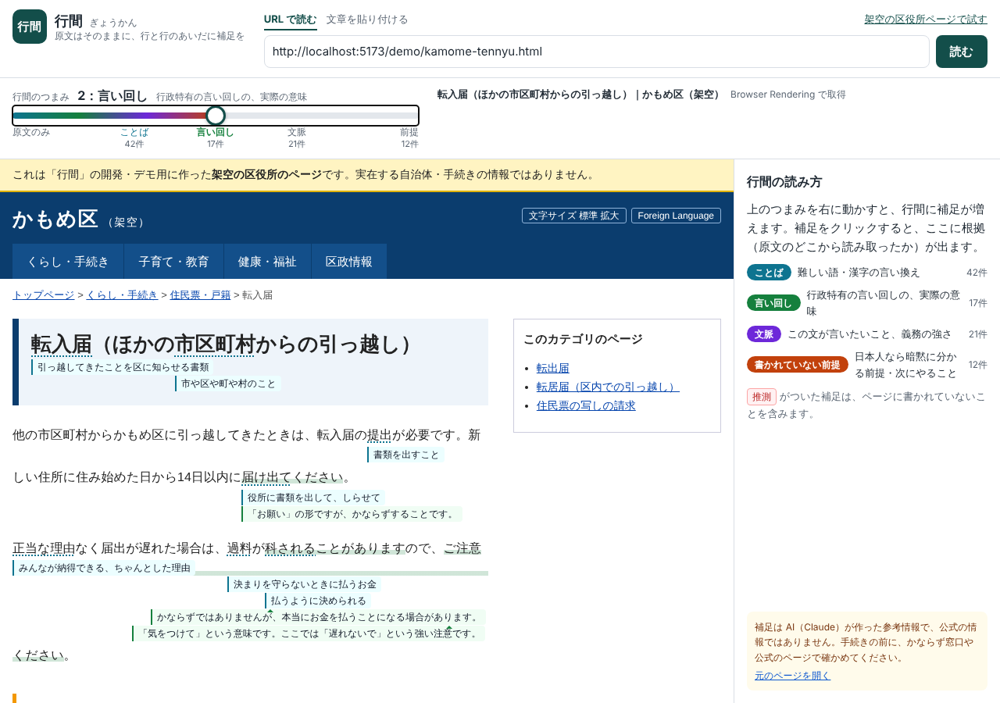
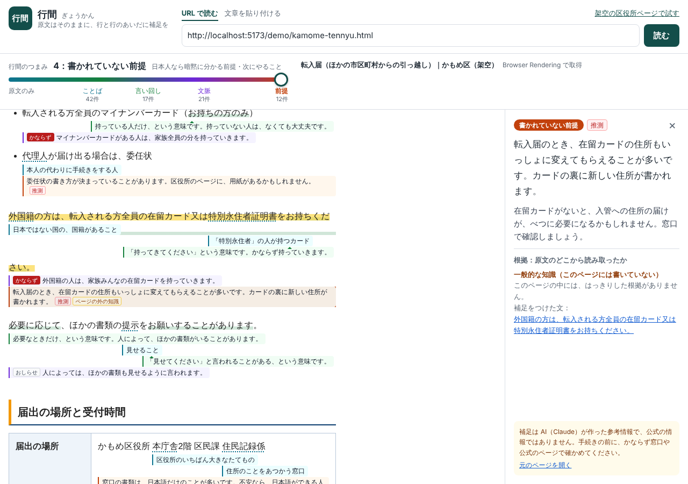
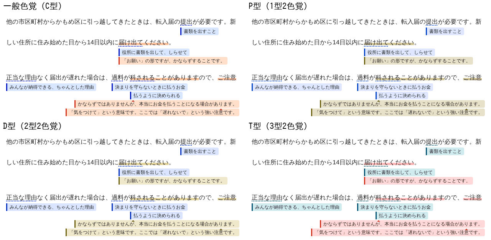

# 行間（ぎょうかん・仮）

日本の公的機関（区役所・出入国在留管理庁など）や、公的な性格のサービスのウェブページを、**原文には一切手を加えずに**、行と行のあいだに「言い換え・本当の意味・文脈・書かれていない前提」を差し込んで読めるようにする Web アプリです。補足の量は「つまみ」で 0〜4 段階に選べます。

> Built with Claude Japan 2026（テーマ#2「本来、誰にでも届くべきものを。」）に向けて開発中です。進捗と判断事項は [PROGRESS.md](PROGRESS.md) にあります。



## 課題と対象者

日本に住んで数年の外国人住民（日本語は日常会話レベル、N3〜N4 程度）が、在留期間の更新・転入届・国民健康保険などの手続きを自分で調べるとき、壁になるのは語彙や漢字だけではありません。「原則として」「必要に応じて」「ご遠慮ください」の本当の意味や、**日本で育った人なら書かれていなくても分かる前提**（平日の昼しか開いていない、本人が行く必要がある、など）が読み取れないことです。

行政文書そのものを書き換えることは難しいので、行間は**外から、原文はそのままに、読む人の側で行間を補います**。

## つまみ（補足のレベル）

| レベル | 名前               | 内容                                                                   |
| ------ | ------------------ | ---------------------------------------------------------------------- |
| 0      | 原文のみ           | 何も足さない                                                           |
| 1      | ことば             | 難しい語の言い換え（読みは補足をクリックすると出る）                   |
| 2      | 言い回し           | 行政特有の言い回しの実際の意味（「ご遠慮ください」＝しないでください） |
| 3      | 文脈               | その文が言いたいこと、義務の強さ（かならず／なるべく／してはいけない） |
| 4      | 書かれていない前提 | 暗黙の前提・次にやること。推測を含むので必ず「推測」と表示する         |

- 補足は**各行の下**に、小さな文字で入ります。語への補足は、その語の真下から始まります。1つの行に補足がいくつかあるときは、重ならないかぎり横に並べ、上の段から詰めます。つまみを動かしても、見えている補足の位置は変わりません。
- 補足には本文だけを書きます。レベルは**色**で、どの語への補足かは**位置**で分かるので、「ことば」などのラベルや語は書きません（色の凡例は右のパネルにあり、補足をクリックするとレベル名と語も出ます）。1行に収めるために語より左へずらしたときは、語の真下に小さな▲を付けます。
- 色は、色覚の型によらず見分けやすいように選んでいます（下の「色について」）。色だけに頼らないよう、ことばの語には点線の下線、言い回しの語にはマーカーを引き、書かれていない前提は左の線を破線にして必ず「推測」と書きます。
- 補足を出しても、**原文の折り返しは変わりません**（行と行のあいだが広がるだけ）。
- 補足をクリックすると、**根拠（原文のどこから読み取ったか）**と、ページ内に根拠があるか・一般的な知識か・推測かが表示されます。



## 使い方（ローカル）

必要なもの: Node.js 22 以上、[Vite+](https://viteplus.dev/)（`npm i -g vite-plus` で `vp` コマンドが入ります）

```bash
vp install
cp .dev.vars.example .dev.vars   # ANTHROPIC_API_KEY を入れると、新しいページの補足をその場で生成できる
vp dev
```

ブラウザで http://localhost:5173 を開き、「架空の区役所ページで試す」を押すと、同梱のデモページ（架空の「かもめ区」の転入届ページ）と補足データで動作を確認できます。

- Browser Rendering はローカルでは Miniflare が手元に Chrome をダウンロードして起動します。**root で動かすコンテナ（CI など）では `CI=1 vp dev`** としてください（`--no-sandbox` が付きます）。
- API キーが無くても、同梱の fixture・取り込んだ補足（下記）・キャッシュ済みの補足は表示できます。

### API を使わずに作った補足を取り込む

Claude Code のセッションや人が作った補足は、下書きを検証してから、開発用の KV に取り込めます（`.dev.vars` の `DEV_TOOLS=1` が必要）。

```bash
vpx scripts/build-fixture.ts local-notes/drafts/<name>.draft.json --api http://localhost:5173 --no-sentences --strict
```

```bash
vpx scripts/import-notes.ts local-notes/<name>.annotations.json
```

`local-notes/` は git に入れません（実在のページの本文を再配布しないため。出力にも本文は含めません）。

### よく使うコマンド

| コマンド                                                     | 内容                                                  |
| ------------------------------------------------------------ | ----------------------------------------------------- |
| `vp dev`                                                     | 開発サーバー（Vue と Worker を一緒に起動）            |
| `vp check`                                                   | 整形（Oxfmt）・Lint（Oxlint）・型チェック（tsgolint） |
| `vp exec vue-tsc -b`                                         | Vue SFC を含めた型チェック                            |
| `vp test`                                                    | テスト（Vitest）                                      |
| `vp build`                                                   | 本番ビルド（`dist/client` と `dist/gyokan`）          |
| `vp run deploy`                                              | ビルドして Cloudflare にデプロイ                      |
| `vpx scripts/segment-page.ts <HTML or URL> [--api <origin>]` | ページを文分割して文 ID を表示                        |
| `vpx scripts/annotate-page.ts <HTML or URL> --out x.json`    | Claude API で1ページ分の補足を生成                    |
| `vpx scripts/build-fixture.ts <下書き.json> --strict`        | 補足の下書きを検証して fixture にする                 |
| `vpx scripts/import-notes.ts <*.annotations.json>`           | 補足を開発用の KV に取り込む                          |

## 仕組み

```
ブラウザ（Vue 3）                         Cloudflare Worker
──────────────────                       ─────────────────────────────
URL を入力 ───────────────────────────→ /api/page
                                           Browser Rendering（ヘッドレス Chrome）で描画後の HTML を取得
                                           （使えないときは通常の fetch）→ HTMLRewriter でサニタイズ
sandbox 付き iframe に表示 ←──────────── サニタイズ済み HTML（ページ本体は保存しない）
（スクリプトは動かない）
本文を文に分割して ID を振る
（shared/segment.ts）
文の一覧を送る（レベルごとに並列）───→ /api/annotate
                                           ① 同梱の fixture ② 取り込んだ補足 ③ KV キャッシュ ④ Claude API で生成
                                           生成: レベル別の指示（サブエージェント）＋構造化出力
                                           検証: 根拠の引用が原文にあるか照合／やさしい日本語のチェック
                                                 → 基準外は1回だけ書き直しを依頼（フック）
文字の位置を測って画面上の行を求め、   ←── 補足（JSON: 文 ID・レベル・補足・根拠・推測フラグ）
各行の下に補足を差し込む（src/lib/render.ts）
```

- **原文は変えない**: 文の範囲を `<gk-s>` で包む・補足の行を行末に足すだけで、原文のテキストは1文字も変えません（テストで確認しています）。
- **折り返しを変えない**: 補足の行は、もともと行が終わる位置に入れる幅 100% のインラインブロックです。小さな文字で横幅を取らず、親の幅の計算にも影響しないようにしています（`contain: inline-size`）。表示する補足が無い行は消すので、つまみ 0 では原文とまったく同じ見た目です。画面の幅が変わったら測り直します。
- **勝手な断定を防ぐ**: モデルが「ページに書いてある」と言った根拠は、引用が原文に本当にあるかを機械的に照合し、確認できなければ「推測」に下げます。
- **キャッシュ**: 補足データだけを本文のハッシュをキーに KV に7日間保存します。取得したページ自体は保存・再配布しません。貼り付けた文章の補足はキャッシュしません。

### 色について

色は[デジタル庁デザインシステム](https://design.digital.go.jp/dads/)のカラートークン（[`@digital-go-jp/design-tokens`](https://github.com/digital-go-jp/design-tokens)）から選び、`src/lib/tokens.css` にまとめています（アプリと、原文を表示する iframe で共通）。

| レベル   | 線・チップの色 | 補足の背景 | 色以外の手がかり                 |
| -------- | -------------- | ---------- | -------------------------------- |
| ことば   | blue-900       | blue-100   | 原文の語に点線の下線             |
| 言い回し | orange-800     | orange-100 | 原文の語にマーカー               |
| 文脈     | cyan-900       | cyan-50    | 文への補足（行の左端から始まる） |
| 前提     | magenta-800    | magenta-50 | 左の線が破線、必ず「推測」       |

デザインシステムの「カラー：アクセシビリティ」の方針に沿って選んでいます。

- **コントラスト比:** 文字は 4.5:1 以上、文字以外は 3:1 以上
- **色の使い方:** 色だけで区別しない。カラーユニバーサルデザイン推奨配色セットを参考にする

`src/lib/tokens.test.ts` で次のことを確かめています。

- **トークンの値:** デザインシステムの値と同じ
- **コントラスト比:** 上の基準を満たす
- **見分けやすさ:** 色覚シミュレーション（P型・D型・T型の2色覚）でも、ことば・言い回し・文脈の3色の色差（CIEDE2000）が 15 以上
- **色の書き方:** CSS に色を直接書かず、トークンだけを使う



### ディレクトリ

```
shared/       クライアント・Worker・スクリプト共通（文分割、プロンプト、検証、Claude 呼び出し）
worker/       Cloudflare Worker（/api/page, /api/annotate）
src/          Vue 3 のフロントエンド
scripts/      文分割・補足生成・検証・取り込みの CLI
fixtures/     Worker に同梱する補足データ（drafts/ は人が編集する下書き。架空のデモページ用）
public/demo/  動作確認用の架空の区役所ページ
local-notes/  実在のページに付けた補足（git 管理外）
```

## 制約・注意

- 補足は AI（Claude）が作る参考情報で、**公式の情報ではありません**。推測は推測と表示し、元のページへのリンクを残します。
- 公的な性格のサイトはドメインでは決められないので、どの公開サイトも読めます（`ALLOWED_HOSTS` で絞ることもできます）。localhost やプライベートネットワークのアドレスは読みません。ログインが必要なページは対象外です。
- サイトによっては、自動での取得を拒否されることがあります。そのときは「文章を貼り付ける」を使ってください。取得のときは「GyokanReader」と名乗り、ブラウザには偽装しません。
- 個人情報は扱いません。「文章を貼り付ける」モードには個人情報を貼り付けないでください。
- 同梱のデモページ（`public/demo/`）は**架空の自治体のページ**で、実在の手続きの情報ではありません。

## ライセンス

MIT の予定です（LICENSE ファイルは公開のときに置きます）。

色の値は、デジタル庁デザインシステムのデザイントークン（[@digital-go-jp/design-tokens](https://github.com/digital-go-jp/design-tokens)、MIT License、© デジタル庁）によります。
